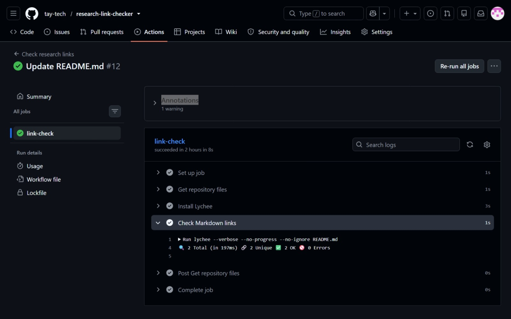

# Research Link Checker

## Project Overview

This project explores how automated tools can identify broken links
in research documentation using GitHub Actions.

## Why This Matters

Research projects often rely on external sources, scientific papers,
datasets, and documentation. Over time, some links may become
unavailable or redirect to different pages.

## Project Objectives

- Understand how GitHub Actions works.
- Set up an automated link-checking workflow.
- Test working and broken links.
- Evaluate the usefulness and limitations of automated checking.

## Status

Currently in development.
## Test Links

- GitHub: https://github.com/
- Python: https://www.python.org/
## Test Results

### Test 1 — Broken Link Detection

- Two links returned successful responses.
- The intentionally broken HTTPBin URL returned `404 Not Found`.
- Lychee reported one error.
- GitHub Actions failed with exit code 2.

### Test 2 — Clean Repository

- The broken test URL was removed.
- Both remaining links passed validation.
- Lychee reported 2 successful links and 0 errors.
- GitHub Actions completed successfully.

### Conclusion

The experiment demonstrated that Lychee can detect an HTTP 404 response in a README file and that GitHub Actions can use the result to determine whether a workflow passes or fails.
## How the Workflow Works

The workflow is defined in `.github/workflows/link-check.yml`.

```yaml
name: Check research links

on:
  push:
    branches: [main]
  pull_request:
    branches: [main]
  workflow_dispatch:

jobs:
  link-check:
    runs-on: ubuntu-latest

    steps:
      - name: Get repository files
        uses: actions/checkout@v4

      - name: Install Lychee
        uses: taiki-e/install-action@v2
        with:
          tool: lychee

      - name: Check Markdown links
        run: lychee --verbose --no-progress --no-ignore README.md
```

The workflow is triggered by repository changes, pull requests targeting `main`, or manual execution. It retrieves the repository files, installs Lychee, and checks the README for links.

If Lychee detects a rejected HTTP response, the command returns a non-zero exit status, causing the workflow to fail.

## Workflow Evidence

### Test 1: Broken Link Detection


The workflow detected the HTTP 404 response and failed with exit code 2.

### Test 2: Successful Link Validation



After removing the broken URL, both remaining links passed validation.

